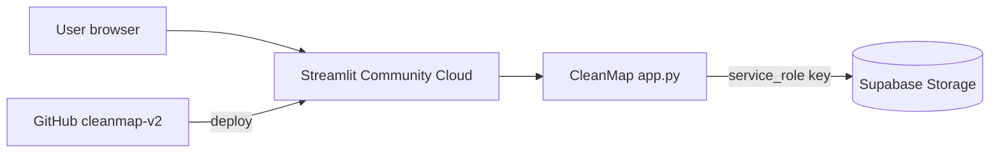

# CleanMap — Version 1 vs Version 2

**Last updated:** November 2025  
**Audience:** Stakeholders, demo users, and migration teams

---

## At a glance

| | **V1 — CleanMap Demo** | **V2 — CleanMap (Production)** |
|---|------------------------|--------------------------------|
| **Folder** | `cleanmap-demo/` | `excel-validator/` |
| **Purpose** | Local demos and screen recordings | Team use online + optional local dev |
| **How to run** | `streamlit run app.py` on your Mac | Streamlit Cloud URL **or** localhost |
| **Login** | None — app opens immediately | Username / password |
| **File storage** | Your machine only (browser session) | **Supabase** private bucket (per user) |
| **Source control** | Copy of project (not the deploy target) | **GitHub:** [CleanMap](https://github.com/akhilsitetracker123/CleanMap.git), branch **`cleanmap-v2`** |
| **Hosting** | Not hosted | **Streamlit Community Cloud** (free tier) |

**V1** matches the product story in *CleanMap Documentation.docx* — validation workflow only.  
**V2** adds everything needed to run CleanMap **on the internet** with **login** and **cloud file storage** (Supabase), deployed from GitHub.

> If you meant **“Supabase”** for cloud hosting of files: V2 uses **Supabase Storage** for files and **Streamlit Cloud** for the app itself.

---

## What both versions do (shared core)

These capabilities exist in **V1 and V2** (same validation engine):

1. **Dynamic schema** — Salesforce three-row header (Label, API Name, Data Type).
2. **Six-step workflow** — Load Excel → field types → lookups → field definitions → mandatory columns → validate → download.
3. **Auto-cleanse** — Trim whitespace, normalize blanks and `#N/A`.
4. **Date normalization** — YYYY-MM-DD (with legacy typo repair).
5. **Stricter date rules** — Reject `0`, `1899-12-30` (Excel zero-date), and year-only values like `2027` as errors.
6. **Lookup resolution** — Optional reference files (Name + Id); Inspector export (`_` on name columns).
7. **Optional warnings** — Unresolved lookup names (warnings, not blockers).
8. **Picklist validation** — Optional object field definition file.
9. **Status column** — `Ready` / `Not Ready` per row.
10. **Excel export** — Cleansed file; optional red/yellow cell highlighting.
11. **Large files** — Sidebar “load from local file path” (V1 always; V2 when not using cloud-only UX).
12. **Formats** — `.xlsx` and `.xls`.

---

## What V2 added (not in V1 demo)

### Online access and security

| Feature | Description |
|---------|-------------|
| **Sign-in page** | `streamlit-authenticator`; users defined in secrets (e.g. `admin`). |
| **Session cookies** | Remember login across refresh; logout clears session and cookies. |
| **Local fallback** | If auth is not configured, “Continue without login” still works for dev. |

### Cloud file storage (Supabase)

| Feature | Description |
|---------|-------------|
| **Private bucket** | e.g. `cleanmap-files`; paths like `{username}/uploads/`, `lookups/`, `field_definitions/`, `outputs/`. |
| **Sidebar: “Upload files to cloud”** | Toggle — pick file type, upload, **list all files**, **download**, **delete**. |
| **Save cleansed output** | “Save to cloud” next to download after validation. |
| **Secrets** | `[auth]` + `[cloud]` in `.streamlit/secrets.toml` (local) or Streamlit Cloud **Secrets** (online). |

Workflow validation (Steps 1–6) stays separate from cloud storage — cloud is for **storing and managing** files, not replacing Step 1 upload.

### GitHub and deployment

| Item | Detail |
|------|--------|
| **Repository** | https://github.com/akhilsitetracker123/CleanMap.git |
| **Deploy branch** | `cleanmap-v2` (recommended for Streamlit Cloud) |
| **Main file** | `app.py` |
| **Initial commit** | Core validator (V1-equivalent app) |
| **V2 commits** | Login, Supabase, logout fixes, Streamlit Cloud auth fixes, cloud sidebar manager, date validation fixes |
| **Dev Container** | `.devcontainer/` for optional VS Code / Codespaces-style dev |

### Documentation and collateral (V2 repo)

- `CLOUD_SETUP.md` — Supabase + Streamlit Cloud setup.
- `generate_documentation.py`, `generate_one_page_summary.py`, `generate_presentation.py` — Word/PPT generators.
- `CleanMap Documentation.docx` (generated from product spec).

### V2-only modules

| File | Role |
|------|------|
| `auth.py` | Login, logout, cookie handling |
| `cloud_storage.py` | Supabase client, upload/list/delete/download |
| `cloud_ui.py` | Sidebar cloud panel |
| Extra dependencies | `streamlit-authenticator`, `extra-streamlit-components`, `supabase` |

---

## Architecture — V2 online



- **App hosting:** Streamlit Cloud pulls code from GitHub.
- **Credentials:** Streamlit **Secrets** (not committed to git).
- **Files:** Supabase Storage (not stored on Streamlit servers long-term).

---

## How to run each version

### V1 — Demo (localhost only)

```bash
cd cleanmap-demo
python3 -m venv .venv
source .venv/bin/activate
pip install -r requirements.txt
streamlit run app.py
```

Open http://localhost:8501 — no login.

### V2 — Local (with login + cloud)

```bash
cd excel-validator
python3 -m venv .venv
source .venv/bin/activate
pip install -r requirements.txt
cp .streamlit/secrets.toml.example .streamlit/secrets.toml
# Edit secrets.toml with auth + Supabase
streamlit run app.py
```

### V2 — Online

1. App on [share.streamlit.io](https://share.streamlit.io) connected to **CleanMap** repo, branch **`cleanmap-v2`**, main file **`app.py`**.
2. Paste full `secrets.toml` content into **App settings → Secrets**.
3. Sign in (e.g. username `admin`).

See **`CLOUD_SETUP.md`** for Supabase bucket and API keys.

---

## Version history (high level)

| Milestone | Version | Summary |
|-----------|---------|---------|
| Initial Salesforce Excel validator | V1 core | Schema, validate, cleanse, export |
| `cleanmap-demo` fork | V1 package | Local demo, no auth/cloud |
| Login + Supabase + logout | V2.0 | Online-ready |
| Streamlit Cloud fixes | V2.1 | Cookie/auth/cache fixes |
| Cloud sidebar manager | V2.2 | Upload / list all / delete |
| Date `0` / year-only / `1899-12-30` | V2.3 | Validation hardening (also synced to demo `validator.py`) |

---

## Which version should you use?

| Scenario | Use |
|----------|-----|
| Sales demo, training video, no accounts | **V1** (`cleanmap-demo`) |
| Team access from anywhere, save files in cloud | **V2** (Streamlit Cloud + Supabase) |
| Developer changing validation rules | Either; **`excel-validator`** is the canonical repo |

---

## Summary

**CleanMap V1 (demo)** is the **documentation-aligned**, **localhost-only** validator — everything needed to prove value on migration Excel files.

**CleanMap V2** is the **same engine** plus **GitHub-backed delivery**, **Streamlit Cloud hosting**, **username/password login**, and **Supabase cloud file management** — built so migration files and outputs can be stored and accessed securely beyond a single laptop session.

---

*For detailed feature descriptions, see `CleanMap Documentation.docx`. For online setup steps, see `CLOUD_SETUP.md`.*